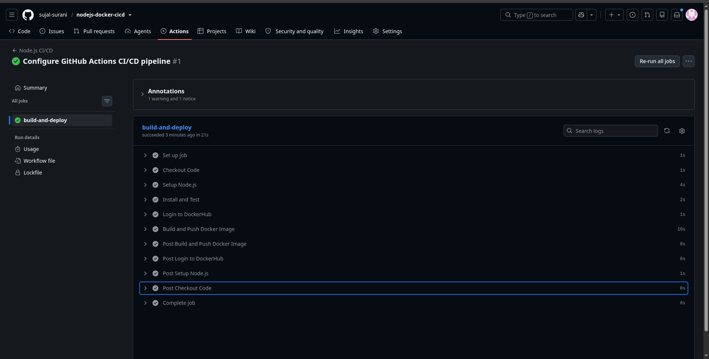

# Node.js Docker CI/CD Pipeline

This repository demonstrates a fully automated CI/CD pipeline for a Node.js web application, built to handle continuous integration and deployment using GitHub Actions and Docker.

## Project Overview
This project configures a complete deployment workflow that automatically triggers on every push to the `main` branch. The pipeline handles the infrastructure automation required to test the source code and securely push the containerized application to DockerHub.

## Pipeline Architecture
The workflow, defined in `.github/workflows/main.yml`, executes the following automated steps:
* **Continuous Integration (Test):** Provisions an Ubuntu runner, sets up the Node.js environment, installs dependencies, and executes sample tests to validate code integrity.
* **Containerization (Build):** Packages the application into a standardized Docker image using the repository's base `Dockerfile`.
* **Continuous Deployment (Push):** Authenticates with DockerHub using encrypted GitHub Secrets to securely deploy the final built image to the container registry.

## Technologies Used
* **Node.js**: Application runtime.
* **Docker & DockerHub**: Containerization and image registry deployment.
* **GitHub Actions**: CI/CD automation, job runner orchestration, and secure secret management.

## Pipeline Execution Details
The following execution log confirms the successful automation of all configured jobs and steps, including the secure DockerHub login and final image deployment.

